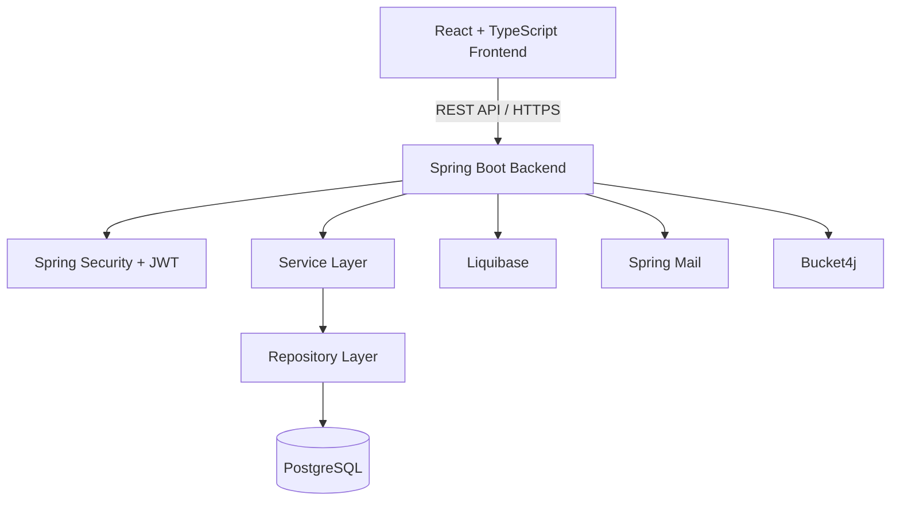

# 📝 TaskWise — Full-Stack Task Management

A full-stack Todo application built with **React, TypeScript, Java 21, and Spring Boot**. It provides a secure environment for managing personal tasks, organizing daily activities, and tracking productivity.

The application follows a RESTful architecture with JWT-based authentication, PostgreSQL persistence, and a responsive user interface.

---

## 🚀 Tech Stack

### Frontend


### Backend


### Database & Tools


---

## ✨ Features

### 🔐 Authentication & Security

- User registration and login.
- JWT-based authentication.
- Access and refresh token management.
- Email verification using OTP.
- Password recovery and reset functionality.
- Secure password hashing.
- User-specific data access.
- Spring Security integration.
- API rate limiting.

### 📋 Task Management

- Create, update and delete tasks.
- Mark tasks as completed or pending.
- Organize tasks by categories.
- Set task priorities.
- Manage task statuses.
- Add tags to tasks.
- Search and filter tasks.
- Sort tasks by different criteria.
- Calendar-based task organization.

### 📊 Dashboard & Productivity

- Overview of total tasks.
- Completed and pending task statistics.
- Task distribution by priority and status.
- Productivity overview.
- Personalized dashboard.

### 👤 User Profile & Preferences

- View and update profile information.
- Change password.
- Manage notification preferences.
- Manage account settings.
- Delete account.

### 🎨 User Interface

- Responsive design.
- Modern dashboard interface.
- Reusable UI components.
- Form validation.
- Loading and error states.
- Protected routes.
- Centralized API communication.

---

## 🏗️ Architecture

The application follows a client-server architecture.



### Backend Architecture

The backend follows a layered architecture:

```text
Controller → Service → Repository → Database
```

- **Controller:** Handles HTTP requests and API responses.
- **Service:** Contains business logic and application rules.
- **Repository:** Manages database operations using Spring Data JPA.
- **Entity:** Represents persistent database objects.
- **DTO:** Defines request and response data structures.
- **Mapper:** Converts between entities and DTOs using MapStruct.
- **Security:** Handles authentication, authorization and JWT processing.
- **Exception Handling:** Provides centralized API error handling.

---

## 📁 Project Structure

```text
todo-app/
│
├── frontend/
│   ├── public/
│   ├── src/
│   │   ├── assets/
│   │   ├── components/
│   │   ├── features/
│   │   ├── hooks/
│   │   ├── layouts/
│   │   ├── pages/
│   │   ├── routes/
│   │   ├── services/
│   │   ├── store/
│   │   ├── types/
│   │   └── utils/
│   │
│   └── package.json
│
├── backend/
│   ├── src/
│   │   ├── main/
│   │   │   ├── java/
│   │   │   │   └── com/todo/
│   │   │   │       ├── common/
│   │   │   │       ├── config/
│   │   │   │       ├── security/
│   │   │   │       ├── auth/
│   │   │   │       ├── user/
│   │   │   │       ├── task/
│   │   │   │       ├── category/
│   │   │   │       ├── notification/
│   │   │   │       └── TodoApplication.java
│   │   │   │
│   │   │   └── resources/
│   │   │       ├── db/
│   │   │       │   └── changelog/
│   │   │       ├── application.yml
│   │   │       ├── application-dev.yml
│   │   │       └── application-prod.yml
│   │   │
│   │   └── test/
│   │
│   ├── build.gradle
│   └── settings.gradle
│
├── .gitignore
├── .env.example
└── README.md
```

---

## ⚙️ Getting Started

### 📌 Prerequisites

Make sure you have the following installed:

- [Java 21](https://adoptium.net/)
- [Node.js](https://nodejs.org/)
- [PostgreSQL](https://www.postgresql.org/)
- [Docker](https://www.docker.com/) (optional)
- [Git](https://git-scm.com/)

### 1. Clone the Repository

```bash
git clone <repository-url>
cd todo-app
```

### 2. Backend Setup

Navigate to the backend directory:

```bash
cd backend
```

Create the PostgreSQL database:

```sql
CREATE DATABASE todo_db;
```

Configure environment variables using the provided `.env.example` as a reference.

Set the active profile:

```env
SPRING_PROFILES_ACTIVE=dev
```

Configure your database credentials and JWT secret.

Run the application:

```bash
./gradlew bootRun
```

On Windows:

```bash
gradlew.bat bootRun
```

The backend will be available at:

```text
http://localhost:8080
```

### 3. Frontend Setup

Navigate to the frontend directory:

```bash
cd frontend
```

Install dependencies:

```bash
npm install
```

Configure the frontend environment variables in `.env`:

```env
VITE_API_BASE_URL=http://localhost:8080/api
```

Start the development server:

```bash
npm run dev
```

The frontend will be available at:

```text
http://localhost:5173
```

---

## 📖 API Documentation

The backend provides RESTful APIs for authentication, users, tasks, categories and other application features.

When running locally, Swagger UI is available at:

```text
http://localhost:8080/swagger-ui.html
```

OpenAPI specification:

```text
http://localhost:8080/v3/api-docs
```

---

## 🧪 Testing

The backend uses:

- **JUnit 5** — Unit and integration testing.
- **Mockito** — Mocking dependencies.
- **Spring Boot Test** — Application testing.
- **Testcontainers** — PostgreSQL integration testing.

Run backend tests:

```bash
./gradlew test
```

Run a clean build:

```bash
./gradlew clean build
```

---

## 🐳 Docker & Deployment

The application is designed to support containerized deployment.

The deployment setup can include:

- React frontend deployment.
- Spring Boot backend container.
- PostgreSQL database.
- Environment-based configuration.
- Liquibase database migrations.
- Production CORS and security settings.

Docker Compose can be used to run the backend and database together during local development.

---

## 🔒 Security Considerations

- Passwords are stored using secure password hashing.
- JWT secrets are provided through environment variables.
- Access tokens have a limited lifetime.
- Refresh tokens support session renewal.
- Protected endpoints require authentication.
- User data is isolated by authenticated user identity.
- Rate limiting helps protect sensitive endpoints.
- Production credentials are not committed to version control.

---

## 🛠️ Development Status

🚧 **Work in Progress**

This project is being developed as a practical full-stack application to strengthen frontend and backend engineering skills, apply software development principles, and explore production-oriented application architecture.

---

## 👨‍💻 Author

**Elşən Həsənov**

- 💼 [LinkedIn](https://linkedin.com/in/elshan-hasanov-4b570624a/)

---
